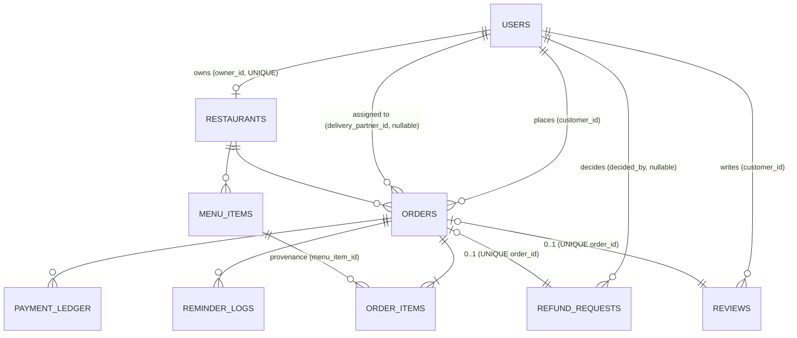

# CampusBite — Database Design (SQLite + SQLAlchemy)

> **Status: APPROVED (reconciled 2026-11-07).** The user's implementation
> batch approved this design and answered every open item (**N1–N8**) with
> decisions **D24–D35** in [decisions.md](decisions.md). This document is
> the build spec for **batch milestone 1** (canonical M2+M3).
> No ORM models and no migration files existed at approval; they are built
> exactly from §1–§2.
>
> **Derived from:** the assignment brief §5/§7/§8/§10, `docs/decisions.md`
> (D1, D2, D3, D5, D6, D7, D9, D11, D18, D20, D21, D22, D23, **D24–D35**,
> plus the 2026-11-07 implementation batch), the development
> contract business rules, `docs/requirements.md` (CK/ORDR/ORDER/DELV/REF/
> REV/BG/DB IDs), `docs/authorization-matrix.md`, `docs/test-plan.md`
> (T-M3-*), and `AGENTS.md`. `AGENTS.md` was confirmed present (created from
> user-provided content, 2026-11-07); no conflicts with this design were
> found.
>
> **How to read this design (student version):** four ideas carry the whole
> schema. (1) **One `users` table** for all three roles, with a `role`
> column — roles are checked in the backend on every request. (2) **Receipts,
> not references:** an order copies the item name and price at purchase time,
> so later menu changes can never rewrite history. (3) **An append-only
> ledger** records every money event; it is never edited. (4) **Three separate
> state machines** (order, payment, refund) that stay in lockstep through
> single transactions.

**Conventions**
- All money is **integer cents, EUR** (D3 + **D26**): `price_cents = 1299`
  means €12.99. Field names are currency-agnostic (`*_cents`); EUR is the
  single documented currency. No floats anywhere.
- All timestamps are **UTC** (D33): app-generated, stored as ISO-8601 text
  in SQLite; `status_updated_at` is stamped **only when status actually
  changes** (a no-op re-POST must not refresh it).
- Booleans are SQLite 0/1 via SQLAlchemy `Boolean`.
- SQLAlchemy types are shown; §7 notes what SQLite actually stores.
- Every table gets `id` (Integer primary key, autoincrement) unless a column
  table says otherwise — `id` is omitted from the tables below as
  self-evident.

---

## 1. Tables and fields

Nine tables: the brief's eight (Users, Restaurants, Menu Items, Orders, Order
Items, Payment Ledger, Reviews, Reminder Logs — the brief's "Admin Reminder
Logs", named `reminder_logs` here) **plus `refund_requests`**, justified below.

> **Table-count reconciliation (2026-11-07 batch):** the batch prompt worried
> the design “appears to require ten” tables; its own numbered list contains
> **nine** names, matching §1.1–§1.9 exactly. The brief (§10) lists eight;
> `refund_requests` is the single justified addition (the brief’s §5 return
> mechanics: required reason, one request per order, pending/approved/
> rejected, who/when decided). **No tenth table is required** — in
> particular, checkout idempotency (D34) is stored as columns **on**
> `orders`, not a new table. If nine tables satisfy the approved
> requirements: **they do**.

### 1.1 `users` — all accounts, one table

**Purpose:** single table for all three roles (customer, restaurant_owner,
delivery_partner). One role per account; the backend checks role + ownership
on every request (D8). Privileged accounts are created only by the local CLI
provisioner (D2).

| Column | SQLAlchemy type | Null | Default | Constraints / notes |
|---|---|---|---|---|
| `email` | String(255) | NO | — | UNIQUE. App lowercases + trims before insert. Login & register look up by this. |
| `password_hash` | String(128) | NO | — | bcrypt output (60 chars; 128 gives headroom). Never the plaintext (D4, D23). |
| `full_name` | String(120) | NO | — | Display name. The owner-protected partner listing returns only `id` + this (D5). |
| `role` | String(20) | NO | `'customer'` | CHECK IN `('customer','restaurant_owner','delivery_partner')`. Public register may only create `customer` (D2). |
| `is_active` | Boolean | NO | `1` | D4: deactivated user → old tokens fail. D5: only active partners assignable. |
| `created_at` / `updated_at` | DateTime | NO | now (UTC) | App-set. |

- **PK:** `id`. **FKs:** none (root entity). **Deletion:** never hard-deleted
  (history anchors) — deactivation via `is_active`.
- **Indexes:** the UNIQUE on `email` doubles as the login index.
  `ix_users_role_active (role, is_active)` — serves the owner's partner
  listing (`WHERE role='delivery_partner' AND is_active=1`).

### 1.2 `restaurants` — the owner's restaurant

**Purpose:** catalog entry and ownership anchor. **One owner ↔ at most one
restaurant** (see §2 — decided, follows D2 + excluded-features).

| Column | Type | Null | Default | Constraints / notes |
|---|---|---|---|---|
| `owner_id` | Integer | NO | — | FK → `users.id`, RESTRICT. **UNIQUE** — one restaurant per owner (D2 provisioning creates the pair atomically). |
| `name` | String(120) | NO | — | |
| `description` | Text | YES | NULL | |
| `address` | String(255) | NO | — | The restaurant's location (public). |
| `delivery_fee_cents` | Integer | NO | `200` | CHECK `>= 0`. Flat per-restaurant fee, snapshotted onto each order at checkout (A5, D3). |
| `created_at` / `updated_at` | DateTime | NO | now | |

- **PK:** `id`. **Indexes:** the UNIQUE on `owner_id` is the ownership-lookup
  index (D8 ownership check, owner dashboards).
- No `is_active` (the brief has no restaurant-closing feature — not invented).

### 1.3 `menu_items` — the *current* menu truth (D3)

**Purpose:** what the restaurant sells **today**. Freely updatable by the
owner (name, price, availability) — historical orders are unaffected because
they snapshot (§3).

| Column | Type | Null | Default | Constraints / notes |
|---|---|---|---|---|
| `restaurant_id` | Integer | NO | — | FK → `restaurants.id`, RESTRICT. |
| `name` | String(120) | NO | — | No uniqueness (a restaurant may offer same-named items — intentional, §10). |
| `description` | Text | YES | NULL | |
| `price_cents` | Integer | NO | — | CHECK `>= 0` (D3: non-negative). |
| `available` | Boolean | NO | `1` | MENU-05 toggle; `DELETE` endpoint soft-removes by setting `0` (RST-03). |
| `created_at` / `updated_at` | DateTime | NO | now | |

- **PK:** `id`. **Indexes:** `ix_menu_rest_avail (restaurant_id, available)`
  for public menu listing. Name search (`LIKE '%q%'`) can't use an index
  (leading wildcard) — fine at capstone scale, documented.

### 1.4 `orders` — the customer's order; anchor for everything else

**Purpose:** one per checkout. Links customer, restaurant, and (later)
delivery partner; carries the server-computed money and **all three state
machines' storage** (§4) plus the address snapshot (§3).

| Column | Type | Null | Default | Constraints / notes |
|---|---|---|---|---|
| `customer_id` | Integer | NO | — | FK → `users.id`, RESTRICT. The ordering customer. |
| `restaurant_id` | Integer | NO | — | FK → `restaurants.id`, RESTRICT. Where it was ordered. |
| `delivery_partner_id` | Integer | **YES** | NULL | FK → `users.id`, RESTRICT. NULL until assignment (READY→ASSIGNED); app validates role + `is_active` (D5). |
| `status` | String(20) | NO | `'PLACED'` | CHECK IN the 9 values (§4.1). D18: strings. The **central state machine** (D7) is the only writer. |
| `payment_status` | String(20) | NO | `'mock_paid'` | CHECK IN `('mock_paid','refunded')`. §4.2. (`'void'` pending policy — §5, §10.) |
| `status_updated_at` | DateTime | NO | now | Stamped on **every** transition (ORDER-09). The reminder scanner's clock (D6). |
| `items_subtotal_cents` | Integer | NO | — | CHECK `>= 0`. Σ line totals, computed server-side (CK-02). |
| `delivery_fee_cents` | Integer | NO | — | CHECK `>= 0`. **Snapshot** of the restaurant's fee at placement (§3). |
| `total_cents` | Integer | NO | — | CHECK `total_cents = items_subtotal_cents + delivery_fee_cents AND total_cents >= 0` — the identity is enforced by the DB, not just the app (CK-06). |
| `delivery_address` | String(255) | NO | — | **Snapshot** at checkout; the partner's delivery detail (DELV-02); no separate address table (excluded: address books). |
| `delivered_at` | DateTime | **YES** | NULL | Set **once** when the order becomes `DELIVERED`; never cleared (**D31**). The review-eligibility criterion, so eligibility survives a later `REFUNDED`. |
| `idempotency_key` | String(64) | NO | — | Client-generated, 1–64 chars (**D34**); provided at checkout. **UNIQUE** together with `customer_id`. |
| `request_hash` | String(64) | NO | — | SHA-256 of the canonicalized checkout payload (D34); same key + different hash → 409. |
| `created_at` / `updated_at` | DateTime | NO | now | `created_at` is the placement time (history filters). |

- **PK:** `id`. **Indexes** (each justified by a named query):
  - `ix_orders_customer_created (customer_id, created_at)` — own history + date filter (ORDR-01).
  - `ix_orders_customer_status (customer_id, status)` — status filter (ORDR-01).
  - `ix_orders_restaurant_status (restaurant_id, status)` — owner dashboard (DASH-01).
  - `ix_orders_restaurant_created (restaurant_id, created_at)` — owner date filter + stats range (DASH-02).
  - `ix_orders_status_updated (status, status_updated_at)` — the reminder scanner's query (BG-02).
  - `ix_orders_partner_status (delivery_partner_id, status)` — partner's assigned list (DELV-01).
  - `uq_orders_customer_key (customer_id, idempotency_key)` — the duplicate-checkout backstop (D34); also the retry-lookup index.

### 1.5 `order_items` — the immutable receipt lines (D3)

**Purpose:** one row per cart line, **frozen at purchase time**. This is the
"policy and proof for all parties": the historical truth, distinct from the
updatable `menu_items`.

| Column | Type | Null | Default | Constraints / notes |
|---|---|---|---|---|
| `order_id` | Integer | NO | — | FK → `orders.id`, RESTRICT. |
| `menu_item_id` | Integer | NO | — | FK → `menu_items.id`, RESTRICT. **Provenance** (which menu row it came from). Stays valid because menu items are only soft-removed (RST-03). |
| `item_name` | String(120) | NO | — | **Snapshot** — never mutated after insert. |
| `unit_price_cents` | Integer | NO | — | **Snapshot**; CHECK `>= 0`. |
| `quantity` | Integer | NO | — | CHECK `quantity > 0` (D3: positive). |
| `line_total_cents` | Integer | NO | — | CHECK `line_total_cents = unit_price_cents * quantity AND >= 0` — DB-enforced identity. |

- **PK:** `id`. **Indexes:** `ix_order_items_order (order_id)` (order detail).
- **Immutability:** no `updated_at` — the application exposes no update path;
  rows are insert-only (enforced by code, noted in ORM docstring).

### 1.6 `payment_ledger` — append-only money trail

**Purpose:** the "payment record" (brief §5) and the §10 relationship "an
order can have multiple payment ledger entries". Every money **event** is a
row: `mock_paid` at placement, `refunded` on approved refund. Rows are never
updated or deleted.

| Column | Type | Null | Default | Constraints / notes |
|---|---|---|---|---|
| `order_id` | Integer | NO | — | FK → `orders.id`, RESTRICT. |
| `type` | String(20) | NO | — | CHECK IN `('mock_paid','refunded')` (`'void'` pending policy — §5/§10). |
| `amount_cents` | Integer | NO | — | CHECK `>= 0`. App rule (D27): **both** `mock_paid` and `refunded` rows always equal `order.total_cents` — full refunds only; the cancellation reversal (D29) uses the same shape. |
| `created_at` | DateTime | NO | now | The event time. |

- **PK:** `id`. **Unique:** `uq_ledger_order_type (order_id, type)` — at most
  one `mock_paid` and one `refunded` row per order; the DB backstop against
  duplicate money events (§6). Also serves the ledger-history query.

### 1.7 `refund_requests` — the return/refund flow (9th table)

**Purpose:** home for brief §5's return mechanics: required reason, one
request per order, pending → approved/rejected, who/when decided. The brief
lists eight tables and its "update the return status to rejected" phrasing
could map to an order column; a table is the cleaner design (decided_by,
timestamps, owner pending-queue query, DB-level one-per-order). **This is the
only additional table; REF-01…06 are the specific requirements that need
it.** The order's own `payment_status` still flips on approval, per the brief.

| Column | Type | Null | Default | Constraints / notes |
|---|---|---|---|---|
| `order_id` | Integer | NO | — | FK → `orders.id`, RESTRICT. **UNIQUE** — one request per order, **permanently, including after rejection** (D28, DB-level backstop). |
| `status` | String(20) | NO | `'pending'` | CHECK IN `('pending','approved','rejected')`. This is the brief's "return status". |
| `reason` | Text | NO | — | Required (brief §5). |
| `requested_at` | DateTime | NO | now | |
| `decided_at` | DateTime | YES | NULL | Set on approve/reject. |
| `decided_by` | Integer | YES | NULL | FK → `users.id`, RESTRICT. App validates = the restaurant's owner (REF-03). |

- **PK:** `id`. **Indexes:** the UNIQUE on `order_id` (guard + lookup);
  `ix_refunds_status (status)` for the owner's pending queue.
- **"Delivered-only"** is an **application** check (the DB can't reference
  another table's status) — §6.

### 1.8 `reviews` — one rating per (delivered) order

**Purpose:** brief §2A11 / §10 "each delivered order can have one review".

| Column | Type | Null | Default | Constraints / notes |
|---|---|---|---|---|
| `order_id` | Integer | NO | — | FK → `orders.id`, RESTRICT. **UNIQUE** — one review per order (REV-03, DB-level). |
| `customer_id` | Integer | NO | — | FK → `users.id`, RESTRICT. Denormalized reviewer; app enforces = the order's customer (so a stranger can't attach a review). |
| `rating` | Integer | NO | — | CHECK `BETWEEN 1 AND 5`. |
| `comment` | Text | YES | NULL | |
| `created_at` | DateTime | NO | now | |

  (customer_id)` for “my reviews”. Eligibility is the application check
  **`orders.delivered_at IS NOT NULL`** (D31 — actually delivered, including
  later-refunded orders); `customer_id` also serves the optional public
  review display (REV-04).

### 1.9 `reminder_logs` — owner reminders for stale orders (brief §8)

**Purpose:** the "Admin Reminder Logs" table. One row per **episode** — an
order sitting > 15 min in `PLACED` or `ACCEPTED` (D6, D20). Displayed on the
owner dashboard; resolved when the order progresses.

| Column | Type | Null | Default | Constraints / notes |
|---|---|---|---|---|
| `order_id` | Integer | NO | — | FK → `orders.id`, RESTRICT. |
| `status_at_reminder` | String(20) | NO | — | CHECK IN `('PLACED','ACCEPTED')` — the episode's status (D20). |
| `detected_at` | DateTime | NO | now | When the scanner first saw it stale. |
| `resolved` | Boolean | NO | `0` | D6: hidden once the order leaves that status. |
| `resolved_at` | DateTime | YES | NULL | |

- **PK:** `id`. **Unique:** `uq_reminders_episode (order_id,
  status_at_reminder)` — one reminder per order+status episode (BG-03). Valid
  because the state machine never revisits a status.
- **Indexes:** the unique above; `ix_reminders_resolved (resolved)` for the
  owner dashboard.
- **Write pattern:** the scanner uses `INSERT … ON CONFLICT
  (order_id, status_at_reminder) DO NOTHING` — duplicate prevention at the DB
  level (§6).

---

## 2. Relationships

- **Restaurant ownership:** `restaurants.owner_id → users.id` is **UNIQUE and
  NOT NULL** — every restaurant has exactly one owner, and each owner has at
  at most one restaurant. **Decision (ratified by D24, 2026-11-07 batch):**
  one owner ↔ one restaurant. The approved documents specified it: D2
  provisions owner + restaurant in a single transaction,
  `excluded-features.md` lists “multiple restaurants per owner” as excluded,
  and `architecture.md` §5 states “one restaurant per owner (D2)”. D24
  records the user's explicit ratification (open item N4 closed).
- **Customers → orders:** `orders.customer_id` — a customer's orders are
  *their* resource (ORDR-01; ownership check D8).
- **Delivery partners → orders:** `orders.delivery_partner_id` is **nullable**
  (unassigned until READY→ASSIGNED) and non-unique — a partner is assigned to
  *many* orders over time (brief §10), and an order to at most one *at a
  time*. "The assigned partner" is found by equality on this column (DELV-01,
  D5's second lock).
- **Orders → menu items via order items:** one order → many `order_items` →
  each points at a `menu_item` (provenance) while carrying its own name/price
  snapshots (§3). The FK makes the link auditable; the snapshots make it
  immutable.
- **Payments / refunds / reviews / reminders → orders:** the ledger and
  reminder logs are one-to-many (append-only events); refund requests and
  reviews are one-to-0..1 via their UNIQUE `order_id` constraints — the
  "one per order" business rules are enforced by the schema itself.

---

## 3. Historical data

Two kinds of data, never confused (D3):

| | "Current truth" | "Historical truth" |
|---|---|---|
| Lives in | `menu_items`, `restaurants` | `order_items`, `orders`, `payment_ledger` |
| Mutability | owner-updatable | **insert-only / append-only** |
| Answers | "what do we sell today, at what price?" | "what did you actually buy, pay, and get?" |

- **Item names & unit prices:** copied into `order_items` at checkout and
  never touched again. The arithmetic identities (`line_total = unit_price ×
  qty`, `total = subtotal + fee`) are CHECK constraints, so a snapshot can't
  silently become incoherent.
- **Delivery address:** snapshotted onto `orders.delivery_address` at
  checkout. There is no customer-address table (address books are excluded);
  the partner's screen and the AI context read the order's own copy, so a
  changed delivery plan can't rewrite the past.
- **Payment & refund history:** the `payment_ledger` is append-only — each
  event (`mock_paid`, `refunded`) is a row with its timestamp. History is the
  *sequence of rows*; nothing is edited in place, so the audit trail is
  provable to both parties (your "policy and proof" rule).
- **When a menu item changes:** renaming or repricing `menu_items` updates
  the *current* row only; every past `order_items` row keeps its old name and
  price (tests §9, T-M3-04/18). Marking a dish **unavailable** sets
  `available = 0` (soft remove, RST-03): it drops from the public menu and is
  rejected at future checkouts (CK-04/MENU-07), while past orders, reviews,
  and the provenance FK all remain intact. Hard-deleting menu rows is never
  done (RESTRICT FKs back this up at the DB layer).

---

## 4. Order and payment states

Three **separate** state machines. They live in different places, are
different concepts, and are never derived from one another — but a few
transitions update two of them **together, atomically** (§5).

### 4.1 Order status — `orders.status` (D7 central machine, D18 strings)

Values: `PLACED, ACCEPTED, PREPARING, READY, ASSIGNED, OUT_FOR_DELIVERY,
DELIVERED, CANCELLED, REFUNDED`. The only writer is the central
`transition_order()` service: a single `UPDATE orders SET status=:to …
WHERE id=:id AND status=:from` (compare-and-swap, §6).

| Current | Action (endpoint) | Allowed actor & ownership condition | Result | Related records changed |
|---|---|---|---|---|
| PLACED | cancel (`/orders/{id}/cancel`) | the order's **customer**; status = PLACED | CANCELLED | `status`, `status_updated_at`, `payment_status → refunded`; **insert** ledger row `refunded` (amount = `total_cents`, **D29**). **No `refund_requests` row** — cancellation is not a refund request. |
| PLACED | accept (`/orders/{id}/accept`) | owner of the order's **restaurant** | ACCEPTED | `status`, `status_updated_at`; PLACED-episode reminder → `resolved` |
| ACCEPTED | start prep (`/orders/{id}/status`) | owner of the restaurant | PREPARING | `status`, `status_updated_at`; ACCEPTED-episode reminder → `resolved` |
| PREPARING | ready | owner of the restaurant | READY | `status`, `status_updated_at` |
| READY | assign partner | owner of the restaurant; target must be `role=delivery_partner` **and** `is_active=1` (D5) | ASSIGNED | `status`, `delivery_partner_id`, `status_updated_at` |
| ASSIGNED | out for delivery | the order's **assigned** partner | OUT_FOR_DELIVERY | `status`, `status_updated_at` |
| OUT_FOR_DELIVERY | deliver | the order's **assigned** partner | DELIVERED | `status`, `status_updated_at` |
| DELIVERED | refund approved (via `/orders/{id}/refund/approve`) | owner of the restaurant; request `pending`; `payment_status` = `mock_paid` | **REFUNDED** | `status`, `payment_status → refunded`, `status_updated_at` (`delivered_at` unchanged); `refund_requests.status → approved` (+`decided_by`, `decided_at`); **insert** ledger row `refunded` (amount = `total_cents`, D27 — full refund; §5.5) |

No other edges exist. In particular: **no `DELIVERED → CANCELLED`** (brief
§4) and no edges out of `CANCELLED`/`REFUNDED` (terminal). Every other
(from, to) pair is rejected `409 INVALID_TRANSITION` (D14 codes, T-M7-01 map
sweep).

### 4.2 Payment status — `orders.payment_status`

| Current | Trigger | Result | Records |
|---|---|---|---|
| (created) | order placement | `mock_paid` | order row + ledger row `mock_paid` (one transaction, §5.2) |
| `mock_paid` | customer **cancellation** of a `PLACED` order (D29) | `refunded` | order row + one `refunded` ledger row |
| `mock_paid` | refund request **approved** on a `DELIVERED` order | `refunded` | as in §4.1 last row; terminal |

third value `void` was considered earlier and **dropped** with D29: the
batch's cancellation policy reuses `refunded` (disambiguated by the order
status), so no new payment value or migration is needed.

### 4.3 Refund-request status — `refund_requests.status`

| Current | Trigger | Result |
|---|---|---|
| `pending` | owner approves | `approved` (+ `decided_by`, `decided_at`) |
| `pending` | owner rejects | `rejected` (+ `decided_by`, `decided_at`); order stays `DELIVERED`, payment stays `mock_paid` |

Both are terminal; the UNIQUE `order_id` allows exactly one request per
order (REF-02) — there is no “second request” state. This permanence is
absolute (D28): a rejected request can never be re-requested for the same
order in v1.

### 4.4 How the three stay consistent

1. **Separate storage, separate checks:** each column has its own CHECK
   constraint, so no value can drift into an illegal *individual* state.
2. **Combined preconditions in the service:** e.g. refund approval requires
   *all three* — order `DELIVERED` + request `pending` + payment
   `mock_paid` — before any write.
3. **One transaction:** the related writes (order row + request row + ledger
   row) commit together or not at all (§5.5), so they can never disagree
   across a crash or an error.
4. **Never interchangeable:** the app never computes one from another (e.g.
   it never infers "order must be REFUNDED because payment is refunded");
   the brief's REFUNDED order status and the `refunded` payment status are
   distinct facts that happen to change together.

---

## 5. Transaction boundaries

SQLite serializes writes (one writer at a time), so "one transaction" is
cheap and safe here — but it must be *short* (D1). Each operation below is
**all-or-nothing**: every write listed either commits together or rolls back
together.

### 5.1 Owner + restaurant provisioning (CLI, D2)
`BEGIN → INSERT users (role='restaurant_owner') → INSERT restaurants
(owner_id = new user) → COMMIT`. If either insert fails (e.g. restaurant
name constraint), **both** roll back — an owner without a restaurant (or an
orphan restaurant) can never exist. Delivery-partner provisioning is the
trivial one-row case. (Test §9, T-M3-19.)

### 5.2 Checkout + mock payment (customer)
`BEGIN → re-read menu items (exist? available? same restaurant? — CK-04) →
snapshot names/prices → INSERT orders (status=PLACED, payment_status=mock_paid,
fee snapshot, server-computed totals) → INSERT order_items → INSERT
payment_ledger (mock_paid, amount = total_cents) → COMMIT`. Any failed
validation → nothing is written → `422` (T-M3-20). The client-supplied total
is never read (D3).

### 5.3 Order cancellation (customer)
`BEGIN → verify status=PLACED (CAS) + ownership → UPDATE orders
(status=CANCELLED, payment_status=refunded, status_updated_at=now) →
INSERT payment_ledger (refunded, amount = total_cents) → COMMIT`.
> **RESOLVED by D29 (2026-11-07 batch):** the customer's cancellation of a
> `PLACED` order performs a **full mock reversal** in the same
> transaction: `payment_status → refunded` and **one `refunded` ledger
> event** (amount = `total_cents`). Cancellation is **not** a refund
> request — it creates no `refund_requests` row, so D28's one-request rule
> stays clean. A second cancellation attempt fails the CAS (`status` is
> already `CANCELLED`) → 409, and the ledger `UNIQUE(order_id, type)` is
> the backstop against a duplicate reversal row. No `void` status is
> needed. (The earlier options (a)/(b)/(c) are closed; the batch chose
> the explicit “money returned” story without a new payment value.)

### 5.4 Delivery assignment (owner)
`BEGIN → verify status=READY (CAS) + ownership → read partner row (role +
`is_active`) → UPDATE orders: status=ASSIGNED, delivery_partner_id,
status_updated_at → COMMIT`. Invalid partner → `422`, nothing changes.

### 5.5 Refund approval (owner) — idempotent
`BEGIN → read order (DELIVERED?), request (pending?), payment (mock_paid?) →
UPDATE refund_requests (approved, decided_by, decided_at) → UPDATE orders
(status=REFUNDED, payment_status=refunded, status_updated_at) → INSERT
payment_ledger (refunded, amount = order.total_cents per D27 —
full refund, no partials) → COMMIT`.
Re-approval finds `status='approved'` → the service returns a **no-op 200**
before writing; the `uq_ledger_order_type` unique is the DB backstop if the
check is ever bypassed (T-M3-22). Rejection is the same shape minus the
payment/ledger writes.

---

## 6. Duplicates and concurrency

Two defense layers, deliberately distinct:
- **Database constraints** = integrity *backstops*: they hold even if an app
  bug bypasses logic (FK, UNIQUE, CHECK). They can't express
  cross-table business rules.
- **Application checks** = business *semantics* (ownership, roles,
  "delivered-only", transition validity) plus, for pure races, the
  compare-and-swap pattern below.

| Threat | DB layer | Application layer |
|---|---|---|
| Duplicate checkout submissions | `UNIQUE(customer_id, idempotency_key)` on `orders` (D34) — under competing identical requests, exactly one insert wins; the loser re-reads and returns the winner's order. | Client sends a bounded key per checkout intent (CK-07); service: same key + same `request_hash` → return the original order; same key + different hash → `409 IDEMPOTENCY_MISMATCH`. The frontend reuses the key on retry and generates a new one for a new intent. |
| Multiple reviews per order | `UNIQUE(order_id)` on `reviews` (REV-03). | Check first → clean `409` instead of a raw IntegrityError. |
| Multiple refund requests per order | `UNIQUE(order_id)` on `refund_requests` (REF-02). | Same pattern; plus "DELIVERED-only" **app** check (DB can't see `orders.status` from this table). |
| Repeated refund ledger entries | `UNIQUE(order_id, type)` on `payment_ledger` — at most one `refunded` per order, ever. | Idempotent service: re-approval is a no-op (§5.5). |
| Duplicate reminders per stale episode | `UNIQUE(order_id, status_at_reminder)` + scanner writes `INSERT … ON CONFLICT DO NOTHING` — a scanner tick can never double a reminder, even under overlap. | Scanner marks `resolved` when the order progresses; a *new* status episode creates a *new* row (D20). |
| Conflicting order-state updates (e.g. customer cancel vs owner accept racing) | The `status` column doubles as the **lock**: the transition is `UPDATE … WHERE id=:id AND status=:from` (compare-and-swap). If another writer changed status first, the UPDATE touches **0 rows** → the service returns `409 INVALID_TRANSITION`. SQLite's single-writer model serializes the two writers, so exactly one CAS wins and the other fails cleanly — no torn or corrupt state. | The central `transition_order()` is the only code path that performs these writes (D7). (T-M3-11/21.) |

---

## 7. SQLite and migrations

- **Foreign-key enforcement on every connection (D1):** SQLite ships with FK
  enforcement **off**, and the pragma is *per connection*. A SQLAlchemy
  event listener runs `PRAGMA foreign_keys = ON;` on every new connection
  (mechanism: `event.listens_for(engine, "connect")`). Forgotten pragma =
  silently orphaned rows, which is why it's a listener, not a one-time setup
  step. Test: orphan insert must fail (T-M3-03/13).
- **Database file location:** `/data/campusbite.db` inside the named Docker
  volume `campusbite-data` (compose mounts it; D1). `DATABASE_URL=
  sqlite:////data/campusbite.db` (four slashes = absolute path) in `.env` /
  `.env.example`. The volume is what survives `docker compose down/up`
  (DB-10, T-M2-05); the file itself is gitignored (D22).
- **Session boundaries (D1):** one SQLAlchemy session per request (opened in
  a FastAPI dependency, closed on exit); the reminder scanner opens its
  **own** session per scan (never shares with a request); the provisioning
  CLI uses its own. All write transactions are short and commit promptly.
- **Migrations (D11 — Alembic):** a committed, **versioned** history
  (`backend/alembic/versions/*.py`). M3 creates the baseline from this
  design; at startup the app auto-applies `alembic upgrade head` — safe only
  in the **documented single-worker** configuration (D1/D6; multiple workers
  racing the same SQLite file must not be documented as supported). The
  manual command is documented in the README. Migration **version files are
  committed**; the `.db` file is not (.gitignore, D22).
- **SQLite-specific limitations relevant to this design (honest list):**
  - **Single writer.** Concurrent writes serialize (brief lock waits). At
    capstone traffic this is a non-issue; the scanner's writes can momentarily
    queue behind a request write — hence short transactions. Optional
    `PRAGMA journal_mode = WAL` (env-configurable, **default off**) reduces
    writer/reader blocking if it ever matters.
  - **Per-connection FK pragma** (above) — the main "silent failure" trap.
  - **Limited ALTER support** (no in-place column type changes) — another
    reason versioned migrations matter more here than in Postgres.
  - **`ON CONFLICT DO NOTHING`** needs SQLite ≥ 3.24 (2018) — the modern
    Docker image ships something far newer; noted for completeness.
  - **Storage types:** Booleans are 0/1; money is INTEGER; **timestamps
    are ISO-8601 text** (D33): every timestamp is generated by the
    application (aware UTC) and stored as
    `YYYY-MM-DD HH:MM:SS.ffffff +00:00` — the database never creates
    time, and the fixed `+00:00` suffix makes lexicographic comparison
    chronologically correct (this is what the scanner's 15-minute rule
    relies on). *Implementation note (batch 1):* the `+00:00` contract is
    carried by the runtime type `app/db/types.py:UTCDateTime` (the stock
    SQLAlchemy 2.0 SQLite `DATETIME` silently drops the timezone); the DDL
    stays plain `DATETIME`, so the migration needs no change.
  - **Dynamic typing (money honesty note, D3):** SQLite `INTEGER` is an
    *affinity*, not a strict type — a float *can* be stored. The "no
    floats anywhere" guarantee is therefore enforced by the application
    layer (Pydantic `int` validation, batch 4+); the schema guarantees
    non-negativity and the total identities (T-M3-08 documents the split).
  - **PostgreSQL is NOT supported or verified** (D1 honesty note): `DATABASE_URL`
    flexibility ≠ tested Postgres support.

---

## 8. Worked example (fictional)

**Casts:** Priya (`u1`, customer) · Sam (`u2`, restaurant owner) · Dana
(`u3`, delivery partner).
**Restaurant:** Slice House (`r1`, owner `u2`, `delivery_fee_cents=200`).
**Menu:** Margherita Pizza (`m1`, `1299`¢) · Garlic Bread (`m2`, `399`¢).

**t1 — Priya checks out:** 2 × Margherita + 1 × Garlic Bread.
Server arithmetic (client totals ignored, D3):
`items_subtotal = 2×1299 + 1×399 = 2598 + 399 = 2997¢`
`total = 2997 + 200 (fee) = 3197¢` → **€31.97**

One transaction creates:

| Table | Row |
|---|---|
| `orders` | `o1` — customer `u1`, restaurant `r1`, partner NULL, `status=PLACED`, `payment_status=mock_paid`, subtotal 2997, fee 200, total 3197, key `ck-01-priya` (request_hash of this exact payload), address “42 Maple Hall, Room 12”, `status_updated_at=t1`, `delivered_at` NULL |
| `order_items` | `oi1` — order `o1`, item `m1`, name "Margherita Pizza", unit 1299, qty 2, line 2598 |
| `order_items` | `oi2` — order `o1`, item `m2`, name "Garlic Bread", unit 399, qty 1, line 399 |
| `payment_ledger` | `pl1` — order `o1`, type `mock_paid`, 3197, `t1` |

*Interlude A (menu drift):* later that day Sam renames `m1` → "Classic
Margherita" at `1499`¢. **`oi1` is untouched** — still "Margherita Pizza"
@ 1299.
*Interlude B (reminder):* Sam is at lunch; `o1` sits in `PLACED` for 16 min.
Scanner tick: `reminder_logs` gets `rm1` (order `o1`, `PLACED`,
`detected_at=t1+16m`, `resolved=0`).
*Interlude C (cancellation, order `o2`):* Priya's second, smaller order
(1 × Garlic Bread: subtotal 399 + fee 200 = **599¢** = €5.99) sits in
`PLACED`; she cancels it. One transaction (D29): `o2.status →
CANCELLED`, `payment_status → refunded`, ledger gets `refunded 599 @ tc`
(one row). **No `refund_requests` row.** `o2.delivered_at` stays NULL —
never delivered, so it can never be reviewed (D31).

**t2 — Sam accepts:** `o1.status → ACCEPTED`, `status_updated_at=t2`; scanner
next tick sets `rm1.resolved=1, resolved_at=t2+1m`.

**t3/t4 — prep:** `o1.status → PREPARING` (t3) → `READY` (t4).

**t5 — Sam assigns Dana** (from the protected listing: `id=u3, "Dana K."` —
no email): `o1.status → ASSIGNED`, `delivery_partner_id=u3`.

**t6 — Dana picks up:** `o1.status → OUT_FOR_DELIVERY` (her dashboard shows
the address snapshot).

**t7 — Dana delivers:** `o1.status → DELIVERED`, `delivered_at = t7` (set once, never cleared — D31).

**t8 — Priya requests a refund** ("arrived cold"): `refund_requests` gets
`rr1` (order `o1`, `pending`, reason, `requested_at=t8`).

**t9 — Sam approves** (one transaction, §5.5):

| Record | Change |
|---|---|
| `refund_requests.rr1` | `status → approved`, `decided_by=u2`, `decided_at=t9` |
| `orders.o1` | `status → REFUNDED`, `payment_status → refunded`, `status_updated_at=t9` |
| `payment_ledger` | **insert** `pl2` — order `o1`, `refunded`, **3197**, `t9` |

**Final state of order `o1`:** status `REFUNDED`, payment `refunded`;
ledger = `[mock_paid 3197 @ t1, refunded 3197 @ t9]` (€31.97 in and €31.97
back — D27 full refund); receipt lines still read “Margherita Pizza @
1299 ×2, Garlic Bread @ 399 ×1” — the history proves exactly what was sold
and what went back. A duplicate approval at t10 is a no-op (unique ledger
backstop). A second refund *request* would be rejected (`UNIQUE order_id` —
D28: no re-request, even after rejection). Priya may **still review** `o1`
— her eligibility is `delivered_at`, which a refund does not erase (D31).

---

## 9. Design tests

Existing IDs reference `docs/test-plan.md`; **new IDs (T-M3-13…23) are
proposed for addition to test-plan.md after your approval** (listed in §10).
"Layer" = where the *protection* lives; every test runs against a throwaway
SQLite DB with the FK pragma active.

| ID | Asserts | Layer |
|---|---|---|
| T-M3-01 / 02 | All nine tables exist; ORM navigations work for every brief-listed relationship | schema |
| T-M3-03 / **13** | **Foreign keys:** orphan insert rejected for every FK column (13 FK columns in the reconciled schema, parametrized) | DB |
| T-M3-05 / 06 / **14** | **Uniqueness:** review-per-order, refund-request-per-order, email, restaurant-per-owner (DB IntegrityError) | DB |
| T-M3-15 | Ledger `UNIQUE(order_id,type)` — a second `mock_paid` or `refunded` row fails | DB |
| T-M3-16 | Reminder episode unique + `ON CONFLICT DO NOTHING` no-ops on re-scan | DB+app |
| T-M3-04 / **18** | **Historical snapshots:** menu rename/reprice/soft-delete leaves past `order_items` and fee snapshots unchanged | DB |
| T-M3-17 | **Check constraints** (parametrized): bad role, bad order/payment/refund status, rating 0 or 6, qty 0, negative price, `total ≠ subtotal+fee`, `line ≠ unit×qty` all rejected | DB |
| T-M3-09 | Migrations: fresh DB → baseline upgrade; a second versioned change applies cleanly | schema |
| **T-M3-19** | **Rollback:** provisioning fails on the restaurant insert → the owner user row does not exist | app (tx) |
| **T-M3-20** | **Rollback:** checkout with one invalid item → zero order/item/ledger rows written | app (tx) |
| T-M3-11 / **T-M3-21** | **Conflicting updates:** two sessions race the same transition → exactly one succeeds, the other gets `409`; no corrupt row | app+DB (CAS) |
| T-M3-06 / **T-M3-22** | **Duplicate prevention:** double refund approval → exactly one ledger `refunded` row; double review/request → clean `409` | app+DB |
| **T-M3-23** | Reminder lifecycle: create → resolve on progress → new episode in new status | app |
| **T-M3-24** | **`delivered_at`:** set once on DELIVERED; preserved through REFUNDED; NULL on CANCELLED orders (D31) | DB+app |
| **T-M3-25** | **Idempotency:** `UNIQUE(customer_id, idempotency_key)` — same customer+key fails; a different customer reusing the same key string is allowed (customer-scoped, D34) | DB |

---

## 10. Review summary

### 10.1 Approved decisions applied
D1 (SQLite/FK pragma/sessions/volume/short writes), D2 (1:1 provisioning),
D3 (integer cents, snapshots, server math, validation), D4 (`password_hash`
sizing, `is_active` as revocation path), D5 (partner nullable FK, active
check, listing fields), D6 (`status_updated_at`, episode dedupe, resolve-on-
progress), D7 (status value set; transition rules encoded as the only legal
edges), D9 (AI reads snapshot/ledger data — the schema is its data source),
D11 (Alembic), D18 (string statuses), D19 (stats read from immutable
snapshots), D20 (episode key), D21 (seed consumes this schema), D22 (DB file
gitignored), D23 (secrets: nothing sensitive lives in the schema/DB),
**D24** (1:1 ownership), **D25** (one restaurant per order), **D26** (EUR),
**D27** (full refunds), **D28** (one request, forever), **D29** (cancellation
reversal), **D30** (refund saga), **D31** (delivered_at reviews), **D32** (soft
menu delete), **D33** (UTC timestamps), **D34** (idempotency), **D35** (stats
metrics read snapshots/ledger), plus the contract's business rules and
brief §5/§8/§10.

### 10.2 Open items N1–N8 — **all RESOLVED (2026-11-07 batch)**
- **N1** refund amount → **D27** (full `total_cents` incl. fee; no partials).
- **N2** cancellation payment policy → **D29** (full mock reversal: `refunded` + one ledger row; no request row; no `void` state).
- **N3** review eligibility after refund → **D31** (the `delivered_at` criterion; a later refund does not erase delivery).
- **N4** 1 owner = 1 restaurant → **D24** (ratified; UNIQUE `owner_id`).
- **N5** duplicate-checkout guard → **D34** (idempotency key is the mechanism; the 60 s near-duplicate 409 is dropped as a false-positive risk).
- **N6** non-unique menu names + zero-price items → **accepted as documented design details** (catalog conveniences; conservative defaults, not business rules).
- **N7** WAL off by default → **confirmed** (config default, env-overridable).
- **N8** `refund_requests` as the 9th table + “return status” mapping → **ratified** (the §1 reconciliation box states the count: nine tables, no tenth needed).

### 10.3 Potential assignment conflicts
None blocking. Notes: (i) the brief lists eight tables — the 9th
(`refund_requests`) is justified by its §5 mechanics, not invented; (ii)
"Admin Reminder Logs" is named `reminder_logs`; (iii) the brief's "update the
return status to rejected" is satisfied by the request table's status (the
order row itself is not touched on rejection). `AGENTS.md` (now present) was
diffed against this design: **no conflicts**.

### 10.4 Implementation order (batch milestone 1 = canonical M2+M3)
1. `app/models.py` — the nine tables + relationships, exactly as §1–§2, **including `delivered_at`, `idempotency_key`, `request_hash` (D31/D34)**. No logic, pure schema.
2. FK-pragma connect listener + session factory (§7; D33 timestamp convention).
3. Alembic baseline generated from the models + startup auto-apply (D11).
4. The §9 tests (T-M3-01…25) run against a throwaway DB — **all green before checkout (batch 4) starts**.
5. Seed script (D21) exercising the schema; then batch 2 (auth) builds directly on
   `users`.
